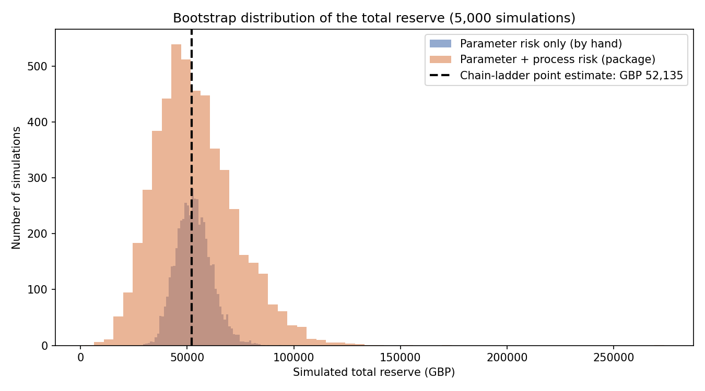

# Chain-Ladder & Bornhuetter-Ferguson Claims Reserving Model

A from-scratch implementation of the two classic General Insurance
claims-reserving methods, built on the industry-standard "RAA" triangle
(Reinsurance Association of America, accident years 1981-1990) and
cross-checked at every stage against the industry-standard `chainladder`
Python package.

## What it does

1. **Loads the claims development triangle** -- cumulative claims paid by
   accident year and development period, with the classic staircase of
   unknown ("not yet developed") cells in the bottom-right.
2. **Implements chain-ladder by hand** -- derives volume-weighted average
   development factors from the known data, then projects every accident
   year forward to its "ultimate" cost, one development period at a time.
3. **Cross-checks the result exactly** against the `chainladder` package's
   own `Development` and `Chainladder` estimators.
4. **Implements Bornhuetter-Ferguson** -- blends the chain-ladder
   projection with an independent, pricing-based prior estimate of ultimate
   claims (an illustrative 75% loss ratio, since the RAA dataset ships no
   premium data), materially damping the reserve for the least mature,
   most volatile accident years.
5. **Quantifies reserve uncertainty with a residual-resampling bootstrap**
   -- builds a "fitted" triangle anchored on each year's last known value,
   computes Pearson residuals against the real data, resamples those
   residuals thousands of times to generate alternate-history triangles,
   and re-runs chain-ladder on each to build a distribution of reserve
   estimates.
6. **Cross-checks the bootstrap** against the package's full
   over-dispersed-Poisson bootstrap, which adds *process risk* (the
   randomness of individual claim outcomes) on top of the *parameter risk*
   captured by the by-hand version.
7. **Charts** both bootstrap distributions against the chain-ladder point
   estimate.

## Key results

| Method | Total reserve | What it tells you |
|---|---|---|
| Chain-ladder (by hand, exact match to package) | £52,135 | Baseline projection from the historical growth pattern |
| Bornhuetter-Ferguson | £44,450 | Damps volatile immature years using a 75% loss-ratio prior |
| Bootstrap -- parameter risk only (by hand) | Mean £53,148, 90% range £40,395-£67,545 | How much the pattern itself could have varied |
| Full ODP bootstrap (package) | Mean £53,826, 90% range £26,706-£87,589 | Adds process risk -- randomness even with a known pattern |



## The core insight

Chain-ladder and Bornhuetter-Ferguson agree closely for mature accident
years, but diverge sharply for the newest ones (e.g. 1990: £16,339 vs
£13,984) -- because chain-ladder multiplies a single, thin data point
through a long chain of growth factors, while Bornhuetter-Ferguson anchors
most of an immature year's estimate to an independent outside view instead.

The two bootstraps reveal a second, subtler insight: adding process risk on
top of parameter risk barely shifts the *mean* reserve estimate (£53,148 ->
£53,826), because process risk is unbiased random noise that averages out
across many simulations -- but it roughly doubles the *spread* (a 90% range
of £27k vs £61k), because any single simulated outcome is now subject to an
extra, genuine source of randomness. Process risk dominates specifically
for the newest, thinnest accident years, since a mature year's total is the
sum of thousands of already-settled claims whose individual randomness has
averaged out by volume (the law of large numbers), while a brand-new year
hasn't had that averaging benefit yet.

## Actuarial concepts covered

- Claims development triangles and the reserving / IBNR problem
- Volume-weighted average development factors, and why they resist
  distortion from small, noisy accident years
- Chain-ladder projection to ultimate
- Bornhuetter-Ferguson: blending an independent a priori estimate with the
  chain-ladder pattern's own "% developed" measure
- Residual-resampling bootstrap (a simplified over-dispersed-Poisson
  bootstrap): fitted triangles, Pearson residuals, resampling with
  replacement
- The distinction between parameter risk and process risk in reserve
  uncertainty

## How to run

```
pip install chainladder pandas numpy matplotlib
python3 reserving_model.py
```

Outputs print to the console and a chart is saved to
`reserving_bootstrap_chart.png`.

## Possible extensions

- Replace the illustrative premiums and 75% loss ratio with real
  pricing-team figures
- Extend Bornhuetter-Ferguson with a full curve of a priori loss ratios by
  accident year, rather than a single flat assumption
- Add the process-variance layer to the by-hand bootstrap directly (drawing
  a further random outcome from a Gamma/Poisson distribution for each
  future cell), rather than relying on the package for that comparison
- Apply the same pipeline to a different triangle (e.g. a longer-tailed
  liability line) to see how the parameter/process risk balance shifts
